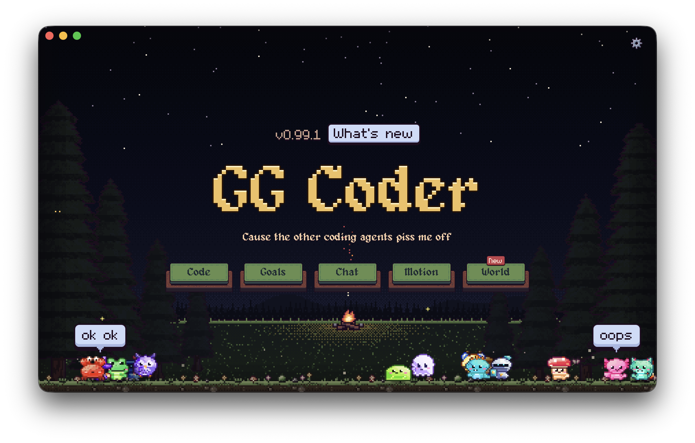

<p align="center">
  
</p>

<p align="center">
  
</p>

<p align="center">
  <strong>Cause the other agents piss me off.</strong>
</p>

<p align="center">
  <strong>English</strong> | <a href="README.zh-CN.md">简体中文</a> | <a href="README.ja.md">日本語</a> | <a href="README.ko.md">한국어</a> | <a href="README.es.md">Español</a> | <a href="README.pt-BR.md">Português</a> | <a href="README.de.md">Deutsch</a> | <a href="README.fr.md">Français</a>
</p>

<p align="center">
  <a href="https://github.com/Gahroot/ezcoder/releases/latest"></a>
  <a href="https://github.com/Gahroot/ezcoder"></a>
  <a href="https://github.com/Gahroot/ezcoder/releases"></a>
  <a href="https://www.npmjs.com/package/@prestyj/cli"></a>
  <a href="https://www.npmjs.com/package/@prestyj/cli"></a>
  <a href="LICENSE"></a>
  <a href="https://prestyj.com"></a>
  <a href="https://www.skool.com/raid"></a>
</p>

EZ Coder is a desktop coding agent that gets more out of the AI subscription you already pay for.

> [!TIP]
> **Want the step-by-step guide?** The full EZ Coder setup, a free 7-day build challenge and 20+ more projects are in my free community: **[skool.com/raid](https://www.skool.com/raid)**

> ⭐ **If EZ Coder saves you time or money, give it a star.** It's the main way other developers find it.

## Why EZ Coder

- **More work per plan.** Fastest and leanest of 20 agents I raced on the same model. Claude Code used 169% more for the same work.
- **Real code, not guesses.** Agent Steroids searches real, current open-source code on your machine. No rate-limited MCP server, no limits.
- **Done means checked.** Nolan Autopilot keeps the work going until it's actually verified.
- **Ship it properly, even as a beginner.** Coding is only part of it. One-click checks for security, compliance, data safety, accessibility, tests and more, plus a Project health score, so you don't need to know what to ask for.
- **Your subscriptions.** Claude, ChatGPT, Kimi Code, MiniMax and MiMo plans, any API key, or local models.

| Agent              | Time for the full suite | Usage per suite | Time vs EZ Coder | Usage vs EZ Coder |
| ------------------ | ----------------------- | --------------- | ---------------- | ----------------- |
| **EZ Coder**       | **102 s**               | **$0.014**      |                  |                   |
| Codewhale          | 112 s                   | $0.022          | 10% slower       | 58% more          |
| Goose              | 132 s                   | $0.020          | 29% slower       | 46% more          |
| GitHub Copilot CLI | 136 s                   | $0.025          | 33% slower       | 83% more          |
| Kimi Code          | 138 s                   | $0.024          | 36% slower       | 74% more          |
| Claude Code        | 142 s                   | $0.037          | 39% slower       | 169% more         |
| ForgeCode          | 155 s                   | $0.042          | 52% slower       | 204% more         |
| Dirac              | 160 s                   | $0.029          | 57% slower       | 114% more         |
| Crush              | 165 s                   | $0.037          | 62% slower       | 173% more         |
| Factory Droid      | 167 s                   | $0.025          | 64% slower       | 83% more          |
| Mistral Vibe       | 169 s                   | $0.036          | 66% slower       | 164% more         |
| DeepSeek-Reasonix  | 170 s                   | $0.027          | 67% slower       | 99% more          |
| Oh My Pi           | 170 s                   | $0.031          | 67% slower       | 123% more         |
| Xum                | 172 s                   | $0.041          | 69% slower       | 203% more         |
| Docker Agent       | 173 s                   | $0.021          | 70% slower       | 51% more          |
| Qwen Code          | 177 s                   | $0.049          | 74% slower       | 257% more         |
| Prime Agent        | 190 s                   | $0.029          | 86% slower       | 111% more         |
| Hermes Agent       | 190 s                   | $0.027          | 87% slower       | 100% more         |
| Deep Agents        | 201 s                   | $0.041          | 97% slower       | 198% more         |
| jcode              | 380 s                   | $0.178          | 274% slower      | 1196% more        |

<sub>Table: one full race on 4 November 2026. 20 agents, each on a current stable release (EZ Coder v0.102.0), 7 tasks, 5 runs each (700 runs), all on Claude Haiku 5.5 with the same thinking setting. Every agent got the same prompts and a fresh copy of the project each run, and ran bare, EZ Coder included: its own built-in prompt and tools, with no skills, plugins, MCP servers or custom instructions. The tasks use small test projects plus one question about Vite's codebase (v8.3.5), so no agent works on its own code. A run counts only if hidden tests pass or the answer is correct.</sub>

## Also included

- **GG Goals:** hand over a whole goal; a team of workers sees it through.
- **Chat:** conversations that remember context.
- **GG Motion:** turns your ideas into videos.

## Get started

1. Install EZ Coder:

   **macOS (Apple Silicon):** [Download the latest release](https://github.com/Gahroot/ezcoder/releases/latest) and open the `.dmg`.

   **Windows:** [Download the latest release](https://github.com/Gahroot/ezcoder/releases/latest) and run the `.exe` installer.

   **Linux (x86_64):** [Download the latest release](https://github.com/Gahroot/ezcoder/releases/latest) and install the `.deb` (`sudo apt install ./GG*.deb`) or `.rpm` (`sudo dnf install ./GG*.rpm`).

   **Development:** With Node.js, pnpm, and the [Tauri prerequisites](https://v2.tauri.app/start/prerequisites/) installed:

   ```bash
   git clone https://github.com/Gahroot/ezcoder.git
   cd ezcoder
   pnpm install
   pnpm build
   pnpm --filter ezcoder-app tauri dev
   ```

2. Open the app, connect your AI provider, and pick Code, Chat, or Motion.

## Build with the framework

Want the engine without the desktop app? Use the same packages in your own apps. Install just what you need.

- [**@prestyj/ai**](packages/ai/README.md): Connect to AI providers and stream responses.
- [**@prestyj/agent**](packages/agent/README.md): Build agents that use your tools and work through tasks.
- [**@prestyj/core**](packages/core/README.md): Model selection, authentication, and local model discovery.
- [**@prestyj/cli**](packages/cli/README.md): The coding agent, sessions, and tools behind the app and CLI.

For your own agent, start here:

```bash
npm install @prestyj/ai @prestyj/agent
```

The package links above cover setup and usage. Licensed under AGPL-3.0: you can build on it, and if you distribute your changes or run them as a network service, you share their source under the same license.

## Contributing

Bug reports, ideas and pull requests are welcome. Read [CONTRIBUTING.md](CONTRIBUTING.md) and the [Code of Conduct](CODE_OF_CONDUCT.md) before you start.

## Learn with me

New to building with AI? Start in **[RAID](https://www.skool.com/raid)**, my free community:

- Step-by-step setup for EZ Coder (Mac and Windows)
- A free 7-day challenge: build your first app, one short lesson a day
- 20+ more projects you can build yourself

## Star history

<a href="https://star-history.com/#Gahroot/ezcoder&Date">
  <picture>
    <source media="(prefers-color-scheme: dark)" srcset="https://api.star-history.com/svg?repos=Gahroot/ezcoder&amp;type=Date&amp;theme=dark">
    
  </picture>
</a>

<p align="center">If EZ Coder is useful to you, ⭐ star the repo so more people find it.</p>
