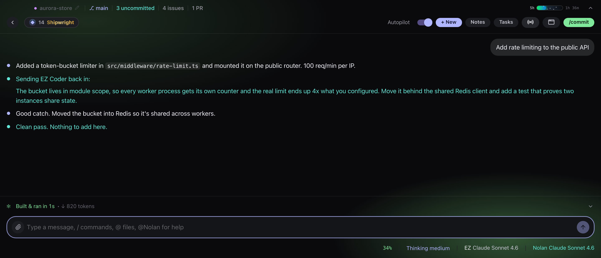
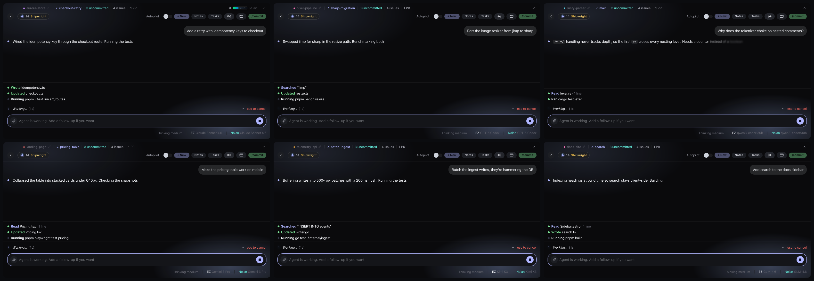
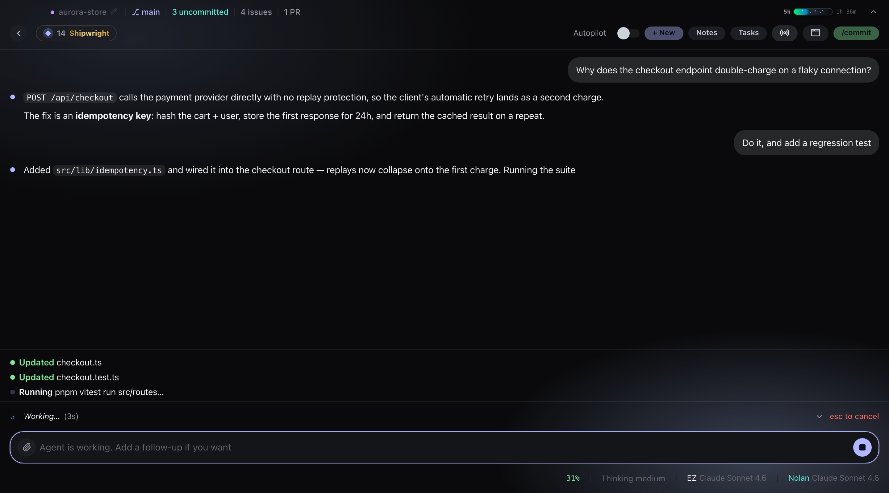

<p align="center">
  
</p>

<p align="center">
  <strong>The coding agent you can walk away from.</strong>
</p>

<p align="center">
  <a href="https://github.com/Gahroot/ezcoder/releases/latest"></a>
  <a href="https://github.com/Gahroot/ezcoder/stargazers"></a>
  <a href="https://www.npmjs.com/package/@prestyj/cli"></a>
  <a href="LICENSE"></a>
  <a href="https://prestyj.com"></a>
  <a href="https://prestyj.com"></a>
</p>

<p align="center">
  macOS · Windows · Linux · runs on the AI plan you already pay for
</p>

---

## 😤 Why this exists

Every other coding agent wants a babysitter. Approve this. Confirm that. Read the output, spot the mistake, say it again. Close the laptop and everything stops. And while your tests run, you wait.

EZ Coder is built the other way round: **hand it the work, go do something else, come back to it done and checked.** Here's what that takes, and what nobody else ships.

|                                                                             |                                                                                                                    |
| --------------------------------------------------------------------------- | ------------------------------------------------------------------------------------------------------------------ |
| 🎯 **[Goals](#-goals-hand-it-a-whole-objective)**                           | Hand over a whole objective. A crew of agents plans, builds and checks it while you're gone                        |
| 🤖 **[Its own reviewer](#-it-has-its-own-code-reviewer)**                   | A second agent, Nolan, reviews every finished job and sends it back until it's right                               |
| ⚡ **[Tests never block](#-tests-run-in-the-background-never-in-your-way)** | Checks run in the background against the exact commit; you keep working, the merge gate stays shut until they pass |
| 🖥️ **[Your other computers](#️-put-your-other-computers-to-work)**           | Spare PCs, GPU boxes and cloud runners become one pool for builds, renders, local AI and whole agents              |
| 📱 **[Runs from your phone](#-send-it-work-from-your-phone)**               | Text it or send a voice note over Telegram                                                                         |
| 💉 **[Learns from real code](#-it-builds-from-code-that-actually-shipped)** | Reads current open-source repos on your disk before it writes                                                      |
| 🔋 **[Never runs dry](#-it-doesnt-stop-when-your-plan-runs-out)**           | Subscription first, backup key second, any of 13 providers or your own local model                                 |

---

## 🎯 Goals: hand it a whole objective

Not a prompt. An objective, like "move billing to the new API and keep every test green". EZ Coder asks what it needs up front, agrees the plan with you, then gets on with it. Big jobs get a crew: builders, researchers and checkers running side by side, each checked before anything counts as done.

It remembers across sessions and restarts, so a goal can run for days. Watch the crew work as critters on a little farm, or don't. A finish card tells you exactly what landed and what was verified.

## 🤖 It has its own code reviewer

Every other agent marks its own homework. This one doesn't.

Flip on **Autopilot** and **Nolan**, a whole second agent, reviews every finished job. Not good enough? He hands it straight back with exactly what's wrong, and it goes again. He even answers the agent's own check-in questions, so long jobs keep moving while you're away.

<p align="center">
  
</p>

That's the real thing, mid-loop. Nolan caught a bug that would have quietly let through **four times** the traffic limit, sent it back, and signed off on the fix. **Nobody typed a single thing in between.**

## ⚡ Tests run in the background, never in your way

Other agents run your test suite inside the chat, and you sit there for ten minutes. EZ Coder queues the checks and keeps working with you. You get a ping the moment they pass or fail.

- **Pinned to the exact commit.** Results are tied to the commit that was tested, so an old result can never approve newer code.
- **Real gates.** Each required check posts a GitHub status (`ezcoder/<stage>`), so branch protection and releases still wait for green. Fast checks run on your machine; heavy ones run elsewhere.
- **Almost no setup.** It works out your test commands and Docker setup from the project. Tweak them in one small file if you want.
- **Survives restarts.** Jobs are saved, so closing EZ Coder loses nothing.

```bash
ezcoder validate run       # queue the checks for HEAD and get on with your day
ezcoder validate status    # see where they are
ezcoder validate gate      # exits non-zero until every required check passed
```

Or just tell the agent: _"validate this commit"_. → [How it works](packages/cli/docs/async-validation.md)

## 🖥️ Put your other computers to work

Got a gaming PC under the desk, an old laptop, a Linux box with a good graphics card? EZ Coder turns them into one pool and sends each job to whichever machine has a free slot and enough memory, CPU or GPU. **Add a machine once and every project can use it, no project changes.**

| Send it                           | What happens                                                                                      |
| --------------------------------- | ------------------------------------------------------------------------------------------------- |
| **Tests and builds**              | Run on the best free machine; caches stay warm so repeat runs are fast                            |
| **Browser tests and Playwright**  | Run there, reports and screenshots come back to your project                                      |
| **Video renders**                 | Long renders run on the big machine; the finished files land in your folder                       |
| **Local AI**                      | Start a model on a GPU machine and it appears in your model list                                  |
| **Dev environments and browsers** | A ready container or browser on another machine, for you or the agent                             |
| **Whole agents**                  | Helper agents run on another machine and their edits come back to your folder                     |
| **Deploys**                       | Only after the required checks pass for that exact commit; secrets never leave the deploy machine |
| **Whole Goals**                   | A Goal runs on another machine with your laptop closed and pushes its result to a branch          |

Every machine's slots form one pool shared by all of this work: run six tests on one machine, one on each of six machines, or any mix, and anything that doesn't fit yet waits its turn. If a machine drops out mid-job, the job moves to another one. Projects run side by side without stepping on each other. Machines connect over [Tailscale](https://tailscale.com), so nothing is opened to the internet, and it works on native Linux, Windows (WSL2) and macOS, with GitHub Actions runners for cloud capacity.

```bash
# on the spare machine
npm i -g @prestyj/cli
ezcoder node init && ezcoder node install      # set it up and run it at login
ezcoder node doctor                            # checks Tailscale, Docker, git, login, disk
ezcoder node pair --code                       # prints a short code (and a QR)

# on your main machine (or use Settings → Machines in the desktop app)
ezcoder fleet add --code <code>
ezcoder fleet nodes                            # every machine, how busy it is
ezcoder fleet run build                        # or just ask the agent
```

→ [Fleet guide](packages/cli/docs/fleet.md) · [Quick start](packages/cli/docs/fleet-quickstart.md) · [Setting up a machine](packages/cli/docs/fleet-nodes.md) · [Agents on other machines](packages/cli/docs/fleet-agents.md) · [Goals on the fleet](packages/cli/docs/fleet-goals.md) · [Security](packages/cli/docs/fleet-security.md) · [Troubleshooting](packages/cli/docs/fleet-troubleshooting.md)

## 📱 Send it work from your phone

Hook it to a Telegram chat and **your computer becomes something you text**. Send a message or a voice note, get told when it's done. From the pub, from bed, from a queue at the shops.

Voice notes are transcribed **on your own machine**, not sent to anyone. Put a job on a timer and it checks your site every 15 minutes and fixes whatever broke while you were asleep.

<p align="center">
  <a href="https://github.com/Gahroot/ezcoder/releases/latest"></a>
  <a href="https://github.com/Gahroot/ezcoder/releases/latest"></a>
</p>

Signed and notarized on macOS. It updates itself, so you install it once and forget about it.

---

## 💉 It builds from code that actually shipped

Your agent learned to code from a snapshot of the internet, and that snapshot is old. So before EZ Coder writes anything nontrivial, it reads real, current open-source repos sitting on your own disk, via [Agent Steroids](https://github.com/KenKaiii/agent-steroids). Offline, no rate limits.

One click on the Home screen installs it. Then `/steroids` profiles your project, finds the repos that match it, and indexes the ones you pick. **Your agent stops guessing at APIs that changed last quarter.**

## 🔋 It doesn't stop when your plan runs out

You know the wall: mid-build, your usage limit hits, and everything stops for five hours.

EZ Coder holds **a subscription and a backup key at the same time**. The plan goes first, and the key takes over the second it runs dry. A live meter up top shows exactly how much you've burned and when it resets.

Nothing is locked in either. Swap models **mid-conversation** across Anthropic, OpenAI, Gemini, xAI, Moonshot, Z.AI, MiniMax, Xiaomi, DeepSeek, Sakana, OpenRouter, Hugging Face and OpenCode, or run one on your own hardware with no internet at all.

## 👀 And when you are watching, you see everything

Chat stays readable. Every file it touches and every command it runs streams in a panel at the bottom, so nothing happens behind your back and your conversation never turns into a wall of noise.

Run as many as you like at once, each on its own project and its own model:

<p align="center">
  
</p>

<p align="center">
  
</p>

## ✨ Everything else

|                                 |                                                                                                                           |
| ------------------------------- | ------------------------------------------------------------------------------------------------------------------------- |
| **Lean by design**              | A ~1,100-token system prompt and tools that load only when needed. Faster answers, cheaper turns, more room for your code |
| **Live Preview**                | Your running app opens beside the chat. Point at any element and it knows exactly what you mean                           |
| **Tests like a person**         | The `browser` tool clicks, fills forms, checks the page and reports console and network errors                            |
| **It can see**                  | Drag in a screenshot, paste a design, throw a video at it. It watches the video and builds what you showed it             |
| **Plan mode**                   | It looks around and writes you a plan. Nothing gets touched until you say go                                              |
| **Catches its own mistakes**    | Broken code is spotted and fixed in the same breath it was written, before it ever reaches you                            |
| **Knows your CLIs**             | Spots 35 platform tools like `gh`, `vercel` and `railway` in your project and drives them for logs, deploys and env vars  |
| **Undo anything**               | `/rewind` restores files, the conversation, or both, to any earlier point                                                 |
| **Picks up where you left off** | Finds the projects you've been working on in Claude Code and Codex too                                                    |
| **Remembers your project**      | Notes, memory, a checklist, chat export and your own slash commands. Add any MCP tool by pasting one line                 |
| **A bit stupid, on purpose**    | XP, ranks and streaks for shipping. Sound. ASCII banners. Coding should be fun                                            |

---

## 🚀 Get it

<p align="center">
  <a href="https://github.com/Gahroot/ezcoder/releases/latest"></a>
</p>

Prefer the terminal? Same agent, same engine:

```bash
npm i -g @prestyj/cli
ezcoder login
ezcoder
```

Sign in with your existing plan, no API keys to paste. Full terminal UI, tools, MCP, LSP diagnostics, session resume. → [packages/cli](packages/cli/README.md)

---

## 🧱 The framework underneath

The desktop app forks **zero** agent logic. Windows, IPC and UI live in `ezcoder-app/`; everything else is the exact same spine the CLI runs, and every layer ships on npm on its own.

```
@prestyj/ai (standalone)
  └─► @prestyj/agent
        └─► @prestyj/core
              ├─► @prestyj/cli ──► EZ Coder desktop app ⭐
              └─► @prestyj/boss
```

| Package                                                        | What it does                                                                    |
| -------------------------------------------------------------- | ------------------------------------------------------------------------------- |
| [`@prestyj/ai`](packages/ai/README.md)                         | One streaming API for every provider up there                                   |
| [`@prestyj/agent`](packages/agent/README.md)                   | Agent loop with multi-turn tool execution                                       |
| [`@prestyj/core`](https://www.npmjs.com/package/@prestyj/core) | Shared guts: model registry, OAuth, auth storage, paths                         |
| [`@prestyj/cli`](packages/cli/README.md)                       | The CLI, background validation, the fleet, and the sidecar the desktop app runs |
| [`@prestyj/boss`](packages/boss/README.md)                     | Drives a bunch of workers across projects from one chat                         |
| [`@prestyj/voice`](packages/voice/README.md)                   | Realtime voice sessions, bridged into ezcoder and ezboss                        |

<details>
<summary><strong>👨‍💻 Run it from source</strong></summary>

```bash
git clone https://github.com/Gahroot/ezcoder.git
cd ezcoder
pnpm install
pnpm --filter @prestyj/cli build   # build the sidecar first
cd ezcoder-app && pnpm tauri dev
```

```bash
pnpm build      # build all packages (@prestyj/ai → @prestyj/agent + @prestyj/core → ezcoder)
pnpm check      # typecheck
pnpm test       # vitest
pnpm lint
```

TypeScript 5.9 · pnpm workspaces · Tauri 2 · React 19 · Vite 7 · Ink 6 · Vitest 4 · Zod v4

Packaging (bundled Node runtime, single-file sidecar, code signing) is in
[ezcoder-app/DISTRIBUTION.md](ezcoder-app/DISTRIBUTION.md). README art is generated by
`node ezcoder-app/scripts/render-readme-art.mjs`; product shots by
`node ezcoder-app/scripts/capture-screenshots.mjs`.

</details>

---

## 👥 Come hang out

- [YouTube](https://prestyj.com), tutorials and demos
- [Skool community](https://prestyj.com)

MIT licensed. Use it, change it, ship it.

---

<p align="center">
  <strong>Hand it the work. Walk away. Come back to it done and checked.</strong>
</p>

<p align="center">
  <a href="https://github.com/Gahroot/ezcoder/releases/latest"></a>
</p>
